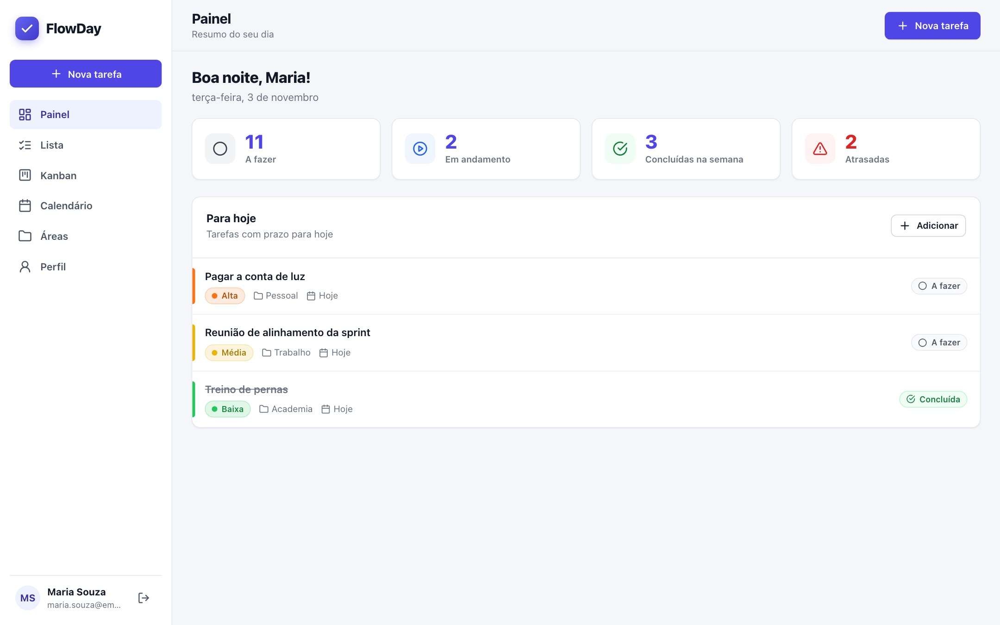
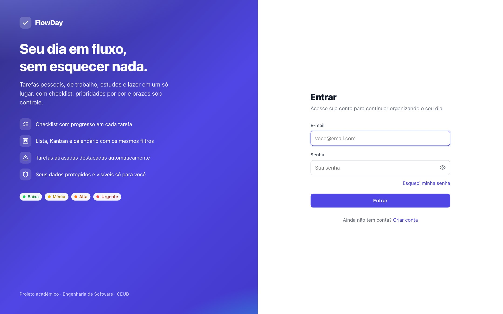
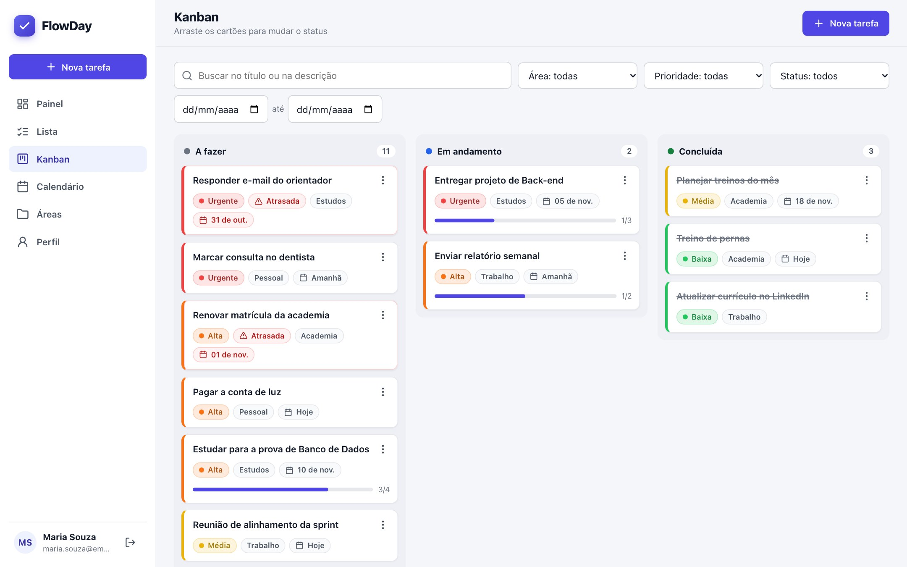
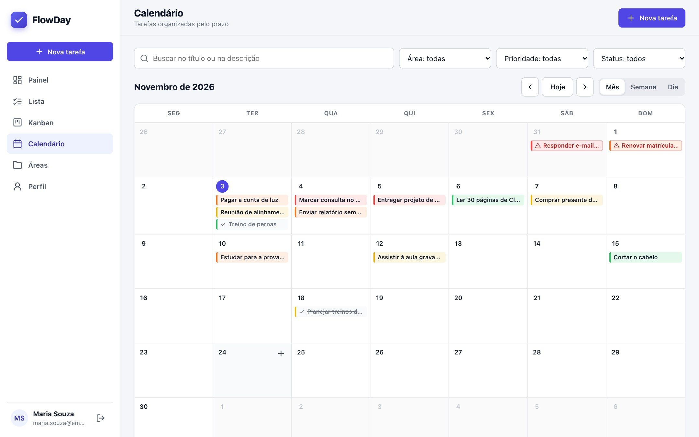

# FlowDay

Plataforma de checklist e produtividade desenvolvida para a disciplina de Back-end do curso de Engenharia de Software do CEUB: **API REST em C#/.NET 8**, **front-end web responsivo**, **MySQL em Docker** e **29 testes automatizados**.



**Demonstração online:** https://hebermacedo.github.io/FLOWDAY/ (modo demonstração: roda no navegador, sem servidor, com os dados salvos só no aparelho; use o botão *Entrar com conta de demonstração*). O sistema completo, com a API em C#/.NET e o MySQL, roda com Docker, como descrito abaixo.

O FlowDay reúne em um só lugar as demandas pessoais, profissionais, acadêmicas e de lazer do usuário. As tarefas são organizadas por áreas, têm prazo, prioridade por cor e rótulo e checklist, e podem ser vistas em lista, quadro Kanban e calendário.

**Equipe:** Marco Antonio de Melo Peixoto e Heber Americo Macedo
**Professor:** Daniel Lim-Apo

## Documentação

| Documento | Conteúdo |
|---|---|
| [BRD](docs/BRD_FlowDay.pdf) | Documento de Requisitos de Negócio: problema, objetivos, stakeholders, RB01 a RB13, regras RN01 a RN23 e fluxos de processo |
| [ERS](docs/ERS_FlowDay.pdf) | Especificação de Requisitos de Software: RF01 a RF43, RNF01 a RNF28, casos de uso e critérios de aceitação |
| [Planejamento](docs/planejamento.md) | Metodologia, cronograma, gráfico de Gantt, divisão de tarefas, backlog e riscos |
| [Diagramas](docs/diagramas.md) | Casos de uso, classes, entidade-relacionamento, sequência, estados, arquitetura e implantação |
| [Documento de evidências](docs/Evidencias_FlowDay.docx) | Solução, arquitetura, planejamento e execução, com prints de todas as telas, do Swagger, dos testes e do banco |

## Tecnologias

| Item | Tecnologia |
|---|---|
| Linguagem e framework | C# com .NET 8 (ASP.NET Core Web API) |
| Banco de dados | MySQL 8.4 em container Docker |
| ORM | Entity Framework Core 8 com o provedor Pomelo.EntityFrameworkCore.MySql |
| Autenticação | JWT (Bearer) com expiração de 60 minutos |
| Senhas | BCrypt (hash com salt) |
| Documentação | Swagger / OpenAPI (Swashbuckle) |
| Testes | xUnit |
| Front-end | HTML, CSS e JavaScript (módulos ES), sem build, servido por nginx em container |
| E-mail em desenvolvimento | Mailpit (servidor SMTP de teste em container) |

## Arquitetura

O projeto segue a arquitetura limpa, com as dependências apontando sempre para o domínio:

```
frontend (navegador) ── HTTP/JSON + JWT ──►  FlowDay.Api

FlowDay.Api  ──►  FlowDay.Infrastructure  ──►  FlowDay.Application  ──►  FlowDay.Domain
   (HTTP)            (EF Core, MySQL,             (casos de uso,             (entidades e
                      BCrypt, SMTP)                DTOs, interfaces)          regras de negócio)
```

| Camada | Responsabilidade |
|---|---|
| **Domain** | Entidades (`Usuario`, `Area`, `Tarefa`, `ItemChecklist`, `RecuperacaoSenha`), enums e as regras de negócio. Não depende de nenhum framework. |
| **Application** | Serviços de cada caso de uso, DTOs de entrada e saída e as interfaces (repositórios, hash, token, e-mail, relógio). |
| **Infrastructure** | Implementações das interfaces: `DbContext`, repositórios com EF Core, BCrypt, envio SMTP e relógio no fuso America/Sao_Paulo. |
| **Api** | Controllers, autenticação JWT, tratamento de erros, limitação de requisições, CORS e Swagger. |

As regras ficam nas entidades. Por exemplo, `Tarefa.AlterarStatus` impede a conclusão com item pendente (RN10) e `Tarefa.AdicionarItem` bloqueia alterações em tarefa concluída (RN12). Assim, a regra vale para qualquer rota que chegue à entidade.

### Estrutura de pastas

```
FlowDay/
├── src/
│   ├── FlowDay.Domain/          Entidades, enums e exceções de domínio
│   ├── FlowDay.Application/     Serviços, DTOs e interfaces
│   ├── FlowDay.Infrastructure/  EF Core, repositórios e serviços externos
│   └── FlowDay.Api/             Controllers, segurança e configuração
├── tests/
│   └── FlowDay.Tests/           Testes automatizados (xUnit)
├── frontend/                    Telas em HTML, CSS e JavaScript (nginx)
├── docs/                        BRD, ERS, planejamento, diagramas e evidências
├── Dockerfile
├── docker-compose.yml
└── .env.example
```

## Pré-requisitos

- [Docker Desktop](https://www.docker.com/products/docker-desktop/) (ou Docker Engine com Docker Compose)
- Opcional, para rodar fora do Docker: [.NET 8 SDK](https://dotnet.microsoft.com/download/dotnet/8.0)

## Como executar

1. Copie o arquivo de exemplo de variáveis de ambiente e troque as senhas e a chave do JWT:

   ```bash
   cp .env.example .env
   ```

   A chave do JWT precisa ter pelo menos 32 caracteres. Para gerar uma: `openssl rand -base64 48`.

2. Suba o banco, o servidor de e-mail, a API e o front-end:

   ```bash
   docker compose up -d --build
   ```

3. Acesse:

   | Serviço | Endereço |
   |---|---|
   | **Aplicação (front-end)** | http://localhost:8081 |
   | Swagger da API | http://localhost:8080/swagger |
   | Caixa de e-mails de teste (Mailpit) | http://localhost:8025 |
   | MySQL (para clientes como DBeaver ou Workbench) | `localhost:3307` |

Na primeira execução, a API cria as tabelas automaticamente. Para parar: `docker compose down`. Para apagar também os dados do banco: `docker compose down -v`.

### Executar a API fora do Docker

Com o .NET 8 SDK instalado, suba só o banco e o Mailpit e guarde a conexão e a chave em *user secrets*, que ficam fora do repositório:

```bash
docker compose up -d mysql mailpit
dotnet user-secrets set "ConnectionStrings:FlowDay" "Server=localhost;Port=3307;Database=flowday;User=flowday;Password=SUA_SENHA;SslMode=Preferred;AllowPublicKeyRetrieval=True" --project src/FlowDay.Api
dotnet user-secrets set "Jwt:Chave" "UMA_CHAVE_COM_PELO_MENOS_32_CARACTERES" --project src/FlowDay.Api
dotnet run --project src/FlowDay.Api
```

A API fica em http://localhost:5080/swagger. Para usar o front-end com ela, suba o container `web` (`docker compose up -d web`) e troque o endereço em `frontend/js/config.js` para `http://localhost:5080`.

## Como usar a aplicação

1. Abra http://localhost:8081 e clique em **Criar conta**. O cadastro já entra no painel, com as áreas Pessoal, Trabalho, Estudos, Lazer e Geral.
2. Use **Nova tarefa** (sempre visível) para criar tarefas com área, prazo, prioridade e checklist.
3. Acompanhe as tarefas em **Lista**, **Kanban** (arraste os cartões ou use o menu ⋮) e **Calendário** (mês, semana e dia). A busca e os filtros valem nas três visualizações.
4. Em **Esqueci minha senha**, o e-mail chega no Mailpit (http://localhost:8025) com o link de redefinição.
5. A interface se adapta ao celular (barra de navegação inferior e botão flutuante).

| Login | Kanban | Calendário |
|---|---|---|
|  |  |  |

## Como testar a API pelo Swagger

1. Em **Autenticação**, use `POST /api/auth/cadastro` (ou `POST /api/auth/login`).
2. Copie o valor de `token` da resposta.
3. Clique em **Authorize**, cole o token e confirme.
4. As rotas protegidas passam a funcionar. O token vale por 60 minutos.

Para testar a recuperação de senha, chame `POST /api/auth/recuperar-senha` e abra o Mailpit em http://localhost:8025. O código está no link do e-mail, depois de `token=`. Use esse código em `POST /api/auth/redefinir-senha`.

## Testes automatizados

Os testes cobrem as regras de negócio do domínio e os serviços da aplicação, com repositórios em memória (sem banco). São 29 casos, todos aprovados, entre eles:

| Teste | Regra |
|---|---|
| Não conclui tarefa com item de checklist pendente | RN10 |
| Tarefa sem itens é concluída e registra data e hora | RN10, RN11 |
| Reabrir a tarefa remove a data de conclusão | RN11 |
| Itens de tarefa concluída não podem ser alterados | RN12 |
| Prazo no passado é recusado; editar tarefa vencida é permitido | RN13 |
| Cálculo de tarefa atrasada | RN14 |
| Limite de 50 itens e tamanho do texto | RN19 |
| Mensagem genérica e bloqueio após 5 falhas de login | RN04 |
| Link de recuperação de uso único; pedido novo invalida o anterior | RN06 |
| Tarefa de outro usuário é tratada como inexistente | RN01 |
| Excluir área move as tarefas para a Geral | RN18 |
| Cadastro cria as cinco áreas padrão; e-mail repetido é recusado | RF02, RN02 |

Para rodar com Docker, sem instalar o .NET:

```bash
docker build --target testes -t flowday-testes .
```

Com o .NET 8 SDK instalado:

```bash
dotnet test
```

## Endpoints

Todas as rotas, exceto as de cadastro, login e recuperação de senha, exigem o token no cabeçalho `Authorization: Bearer <token>`.

| Método | Rota | Descrição |
|---|---|---|
| POST | `/api/auth/cadastro` | Cria a conta e já autentica |
| POST | `/api/auth/login` | Login com e-mail e senha |
| POST | `/api/auth/logout` | Encerra a sessão no aparelho |
| POST | `/api/auth/recuperar-senha` | Envia o link de redefinição |
| POST | `/api/auth/redefinir-senha` | Define a nova senha pelo código do link |
| GET | `/api/perfil` | Dados do usuário |
| PUT | `/api/perfil` | Altera nome e e-mail (o e-mail exige a senha atual) |
| PUT | `/api/perfil/senha` | Altera a senha e invalida as outras sessões |
| DELETE | `/api/perfil` | Exclui a conta e todos os dados |
| GET | `/api/areas` | Lista as áreas |
| GET | `/api/areas/{id}` | Consulta uma área |
| POST | `/api/areas` | Cria uma área |
| PUT | `/api/areas/{id}` | Renomeia uma área |
| DELETE | `/api/areas/{id}` | Exclui a área e move as tarefas para a Geral |
| GET | `/api/tarefas` | Lista paginada, com busca, filtros e ordenação |
| GET | `/api/tarefas/kanban` | Tarefas agrupadas por status |
| GET | `/api/tarefas/calendario?inicio=&fim=` | Tarefas com prazo no período |
| GET | `/api/tarefas/{id}` | Consulta uma tarefa com o checklist |
| POST | `/api/tarefas` | Cria uma tarefa |
| PUT | `/api/tarefas/{id}` | Altera uma tarefa (envie todos os campos) |
| PATCH | `/api/tarefas/{id}/status` | Altera o status |
| DELETE | `/api/tarefas/{id}` | Exclui a tarefa e seus itens |
| POST | `/api/tarefas/{id}/itens` | Adiciona um item ao checklist |
| PUT | `/api/tarefas/{id}/itens/{itemId}` | Edita o texto do item |
| PATCH | `/api/tarefas/{id}/itens/{itemId}/concluido` | Marca ou desmarca o item |
| DELETE | `/api/tarefas/{id}/itens/{itemId}` | Exclui o item |
| GET | `/api/painel` | Indicadores e tarefas do dia |

Filtros de `GET /api/tarefas`, `kanban` e `calendario`: `busca`, `areaId`, `prioridade` (`Baixa`, `Media`, `Alta`, `Urgente`), `status` (`AFazer`, `EmAndamento`, `Concluida`), `prazoDe` e `prazoAte`. A lista aceita ainda `ordenarPor` (`Prazo`, `Prioridade`, `Criacao`), `ordem` (`asc` ou `desc`), `pagina` e `tamanho` (máximo 100).

## Tratamento de erros

Todos os erros seguem o formato Problem Details (RFC 7807), com código HTTP adequado, mensagens em português e sem detalhes internos. Isso vale também para JSON malformado, parâmetros ausentes e valores em formato inválido:

| Código | Quando ocorre |
|---|---|
| 400 | Dados inválidos (com a lista de campos em `errors`) |
| 401 | Credenciais incorretas ou sessão ausente ou expirada |
| 404 | Recurso inexistente ou de outro usuário |
| 409 | E-mail ou nome de área já em uso |
| 422 | Regra de negócio violada (ex.: concluir tarefa com item pendente) |
| 423 | Login bloqueado após 5 falhas |
| 429 | Muitas requisições em pouco tempo nas rotas de autenticação |
| 500 | Erro inesperado (registrado no log, com mensagem genérica ao usuário) |

Exemplo:

```json
{
  "type": "https://tools.ietf.org/html/rfc4918#section-11.2",
  "title": "Regra de negócio violada",
  "status": 422,
  "detail": "A tarefa só pode ser concluída quando todos os itens do checklist estiverem concluídos.",
  "instance": "/api/tarefas/3f2c.../status",
  "traceId": "0HN7..."
}
```

## Segurança

- Senhas guardadas apenas como hash BCrypt.
- Token JWT assinado com chave lida de variável de ambiente e expiração de 60 minutos.
- Trocar ou redefinir a senha invalida todos os tokens emitidos antes, pelo carimbo `sv` gravado no token.
- Toda consulta é filtrada pelo usuário autenticado; dado de outro usuário responde como inexistente.
- Limite de 10 requisições por minuto, por IP, em cadastro, login e recuperação de senha.
- Código de recuperação aleatório, de uso único, válido por 30 minutos e guardado só como hash SHA-256.
- CORS restrito ao endereço do front-end, configurado em `Cors:Origens`.
- O logout é feito pelo front-end, descartando o token, já que a API é stateless.
- No front-end, todo texto do usuário é escapado antes de entrar no HTML (proteção contra XSS), e o nginx envia `X-Frame-Options`, `X-Content-Type-Options` e `Referrer-Policy: no-referrer` (o código de redefinição de senha, que vai na URL, não vaza para outros sites).

## Observações

- As tabelas são criadas com `EnsureCreated` na primeira execução, o que simplifica a correção do trabalho. Em uma evolução do projeto, o próximo passo seria passar a usar *migrations* do EF Core.
- As datas são gravadas em UTC. O "dia atual" (prazos, atrasos e painel) segue o fuso America/Sao_Paulo.
