# Diagramas do FlowDay

Os diagramas abaixo usam [Mermaid](https://mermaid.js.org/) e são desenhados automaticamente pelo GitHub. As versões em imagem estão em [`docs/imagens/`](imagens/) e no documento de evidências.

Os diagramas de casos de uso, de contexto e o modelo conceitual de dados também aparecem no [ERS](ERS_FlowDay.pdf). Os fluxos de processo (atual e futuro) estão no [BRD](BRD_FlowDay.pdf).

Sumário:

1. [Diagrama de casos de uso](#1-diagrama-de-casos-de-uso)
2. [Arquitetura em camadas](#2-arquitetura-em-camadas)
3. [Diagrama de implantação (Docker)](#3-diagrama-de-implantação-docker)
4. [Diagrama de classes: domínio](#4-diagrama-de-classes-domínio)
5. [Diagrama de classes: aplicação e infraestrutura](#5-diagrama-de-classes-aplicação-e-infraestrutura)
6. [Diagrama entidade-relacionamento](#6-diagrama-entidade-relacionamento)
7. [Diagrama de estados da tarefa](#7-diagrama-de-estados-da-tarefa)
8. [Sequência: login](#8-diagrama-de-sequência-login)
9. [Sequência: concluir tarefa](#9-diagrama-de-sequência-concluir-tarefa)
10. [Sequência: recuperação de senha](#10-diagrama-de-sequência-recuperação-de-senha)
11. [Sequência: excluir área](#11-diagrama-de-sequência-excluir-área)

---

## 1. Diagrama de casos de uso

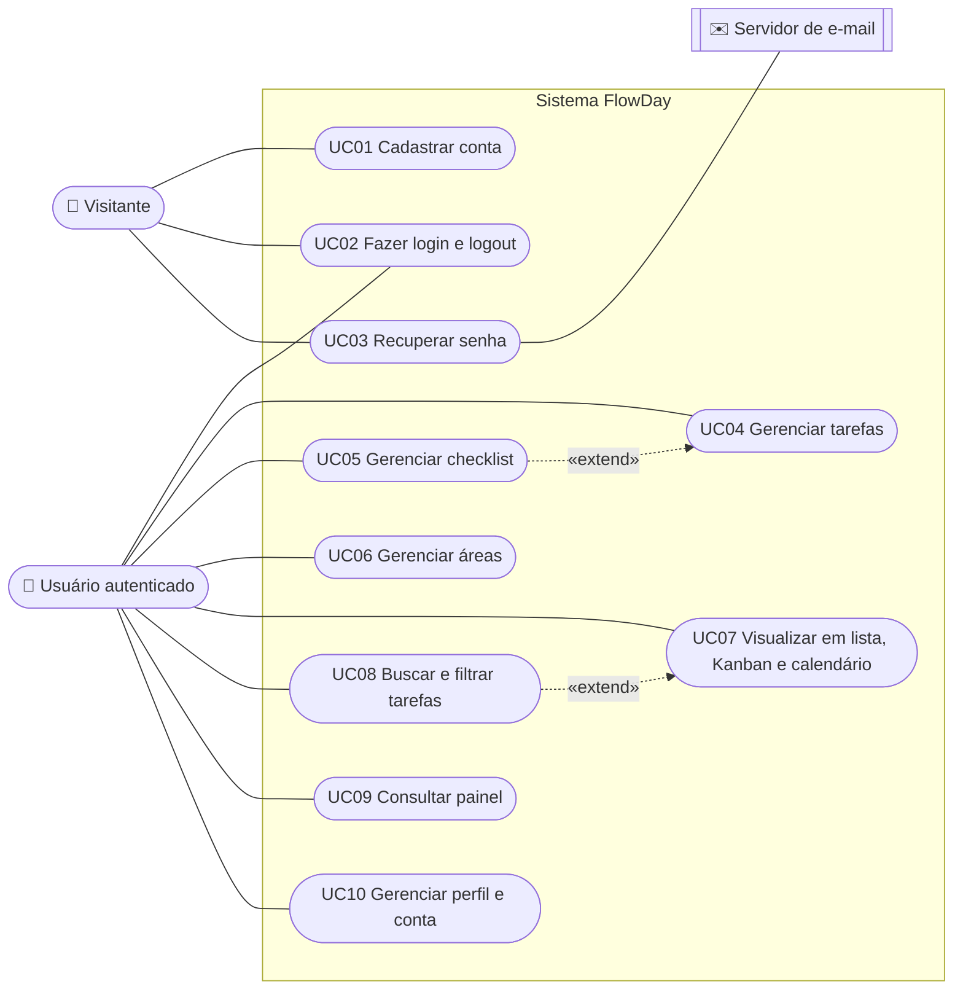

## 2. Arquitetura em camadas

As dependências apontam sempre para o domínio (arquitetura limpa). O domínio não conhece banco, HTTP nem frameworks.

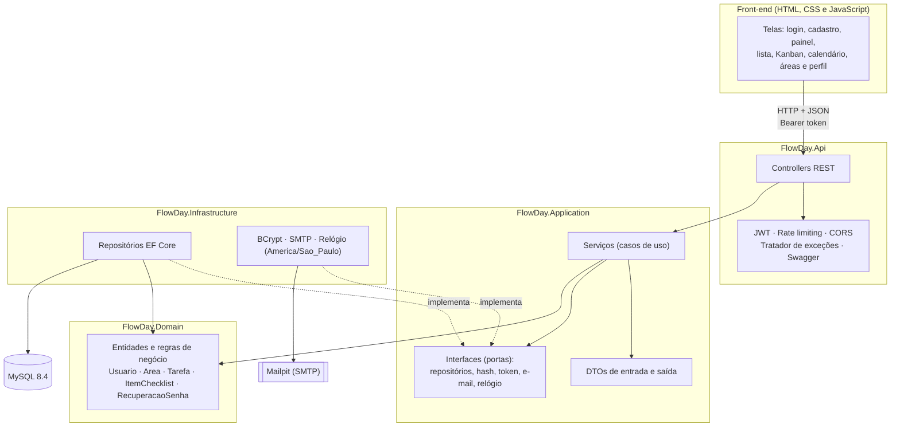

## 3. Diagrama de implantação (Docker)

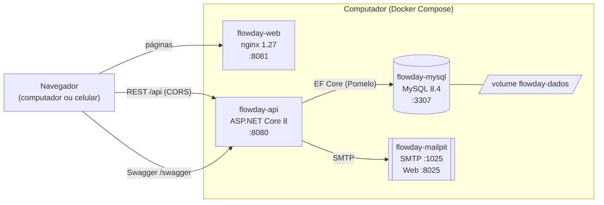

## 4. Diagrama de classes: domínio

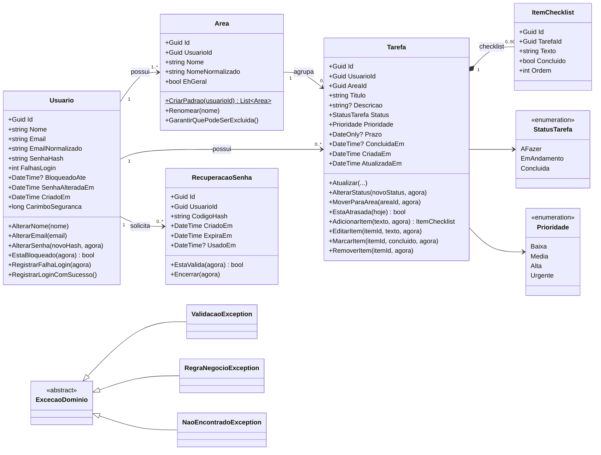

## 5. Diagrama de classes: aplicação e infraestrutura

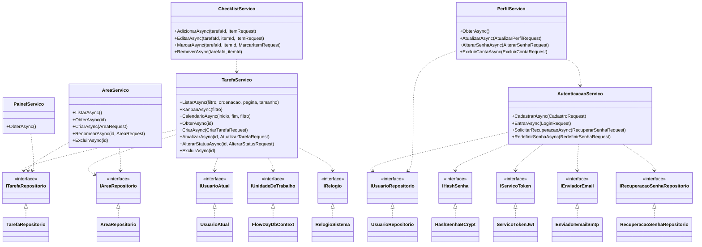

`ServicoTokenJwt` e `UsuarioAtual` ficam na camada de API, pois dependem do ASP.NET Core. Os demais adaptadores ficam na infraestrutura.

## 6. Diagrama entidade-relacionamento

Modelo físico gerado pelo Entity Framework Core no MySQL. Chaves primárias são `char(36)` (GUID gerado no domínio).

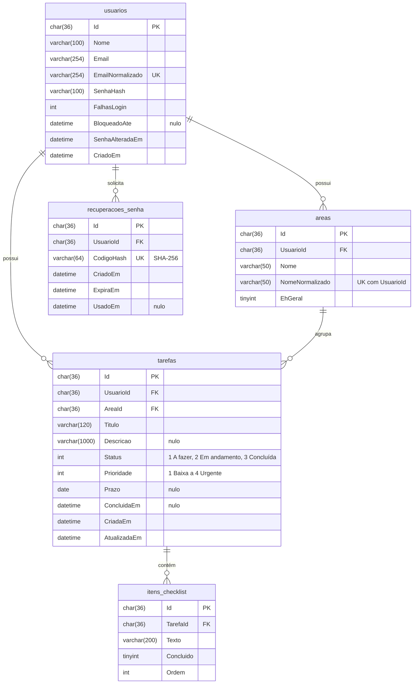

Regras de integridade:

| Relacionamento | Exclusão |
|---|---|
| usuarios → areas, tarefas, recuperacoes_senha | Cascata (excluir a conta remove tudo, RN21) |
| areas → tarefas | Restrita: as tarefas são movidas para a Geral antes (RN18) |
| tarefas → itens_checklist | Cascata (excluir a tarefa remove os itens, RN21) |

Índices: `usuarios.EmailNormalizado` (único, RN02), `areas (UsuarioId, NomeNormalizado)` (único, RN16), `tarefas (UsuarioId, Status)` e `tarefas (UsuarioId, Prazo)` (Kanban, calendário e painel), `recuperacoes_senha.CodigoHash` (único).

## 7. Diagrama de estados da tarefa

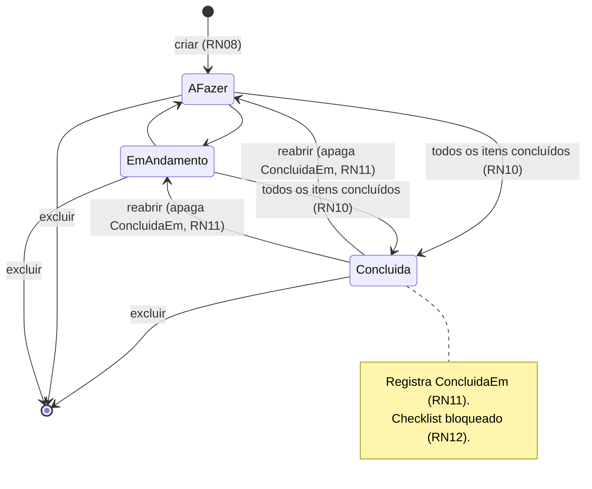

## 8. Diagrama de sequência: login

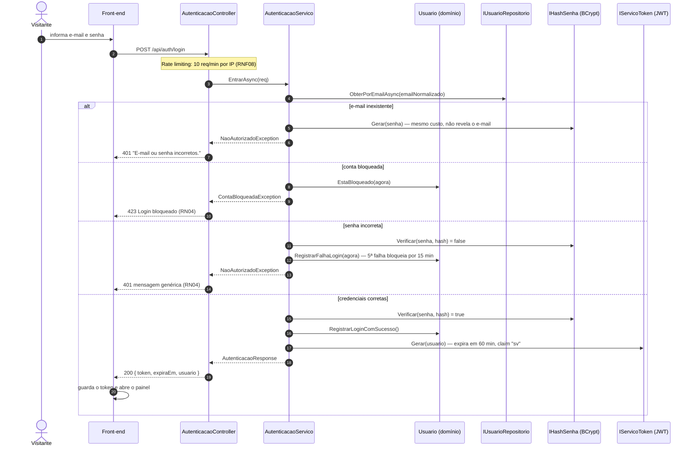

## 9. Diagrama de sequência: concluir tarefa

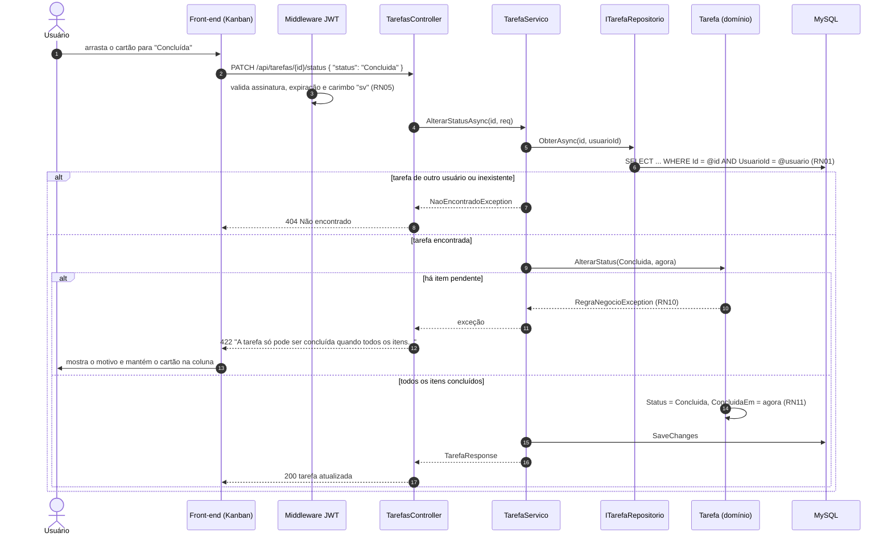

## 10. Diagrama de sequência: recuperação de senha

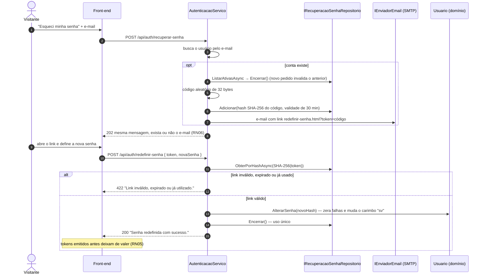

## 11. Diagrama de sequência: excluir área

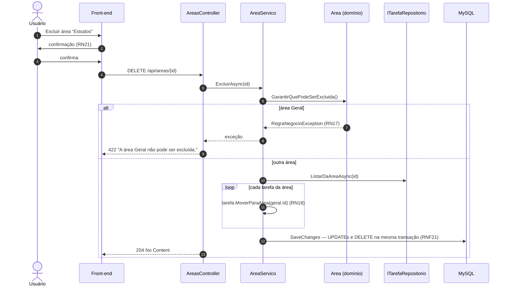
