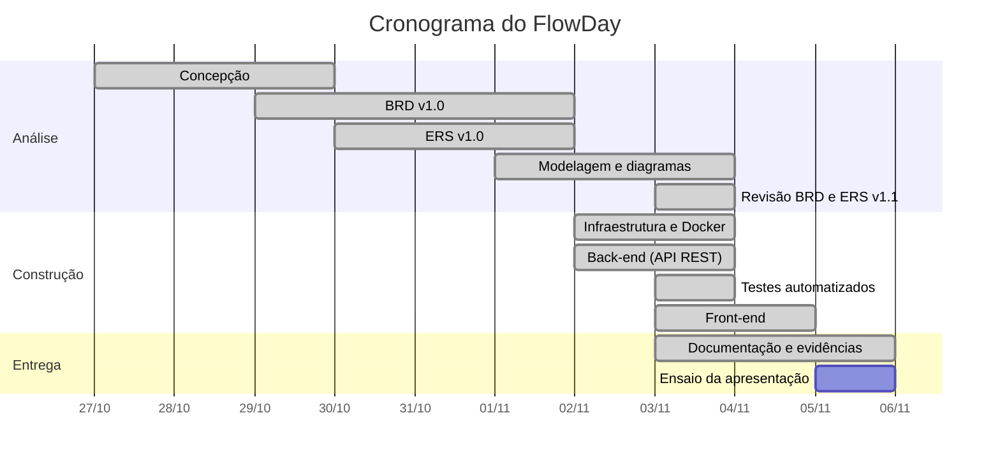

# Planejamento do projeto FlowDay

**Disciplina:** Back-end · Engenharia de Software · CEUB
**Equipe:** Marco Antonio de Melo Peixoto e Heber Americo Macedo
**Professor:** Daniel Lim-Apo

## 1. Metodologia

O trabalho foi conduzido em ciclos curtos, inspirados no Scrum e acompanhados em um quadro Kanban (A fazer, Em andamento, Concluído), o mesmo conceito que o FlowDay oferece aos seus usuários.

- **Planejamento por fases:** cada fase tem um entregável verificável (documento, diagrama, código ou teste).
- **Rastreabilidade:** requisitos de negócio (RB) → requisitos funcionais (RF) → regras de negócio (RN) → código e testes. As regras citadas nos comentários do código (por exemplo, `// RN10`) apontam para o BRD e o ERS.
- **Definição de pronto:** a funcionalidade compila, respeita as regras de negócio, tem tratamento de erro padronizado, aparece documentada no Swagger e, quando envolve regra de negócio, tem teste automatizado.
- **Controle de versão:** código no GitHub, com histórico de versões dos documentos no próprio BRD e ERS.

## 2. Cronograma

| # | Fase | Atividades | Entregável | Início | Fim | Responsáveis |
|---|---|---|---|---|---|---|
| 1 | Concepção | Escolha do tema, análise de ferramentas parecidas, definição de escopo e público | Tema e escopo definidos | 27/10/2026 | 29/10/2026 | Marco e Heber |
| 2 | Requisitos de negócio | Problema, objetivos, stakeholders, RB01 a RB13, RN01 a RN23, fluxos de processo e critérios de sucesso | BRD v1.0 | 29/10/2026 | 01/11/2026 | Marco (líder) e Heber |
| 3 | Requisitos de software | RF01 a RF43, RNF01 a RNF28, casos de uso, critérios de aceitação CA01 a CA43 | ERS v1.0 | 30/10/2026 | 01/11/2026 | Heber (líder) e Marco |
| 4 | Modelagem | Casos de uso, contexto, modelo conceitual, classes, ER, estados e sequência | Diagramas | 01/11/2026 | 03/11/2026 | Marco e Heber |
| 5 | Revisão | Revisão cruzada do BRD e do ERS e alinhamento com a modelagem | BRD v1.1 e ERS v1.1 | 03/11/2026 | 03/11/2026 | Marco e Heber |
| 6 | Infraestrutura | Solução .NET em camadas, Docker Compose, MySQL, EF Core, Mailpit | Ambiente executável | 02/11/2026 | 03/11/2026 | Heber |
| 7 | Back-end | Domínio, serviços, repositórios, API REST, JWT, BCrypt, rate limiting, tratamento de erros, Swagger | API completa | 02/11/2026 | 03/11/2026 | Heber (API e segurança) e Marco (domínio e regras) |
| 8 | Testes | Testes automatizados das regras de negócio (xUnit) | 31 testes aprovados | 03/11/2026 | 03/11/2026 | Marco |
| 9 | Front-end | Telas de login, cadastro, recuperação de senha, painel, lista, Kanban, calendário, áreas e perfil | Interface responsiva | 03/11/2026 | 04/11/2026 | Marco (telas) e Heber (integração com a API) |
| 10 | Documentação | README, diagramas, planejamento e documento de evidências | Documentação final | 03/11/2026 | 05/11/2026 | Marco e Heber |
| 11 | Apresentação | Roteiro, ensaio e demonstração em sala | Apresentação à turma | Data definida pelo professor | | Marco e Heber |

## 3. Divisão de tarefas

| Área | Marco Antonio de Melo Peixoto | Heber Americo Macedo |
|---|---|---|
| Análise | Problema, objetivos, stakeholders e fluxos de processo (BRD) | Requisitos funcionais, não funcionais e critérios de aceitação (ERS) |
| Regras de negócio | Redação e revisão das RN01 a RN23 | Revisão e rastreabilidade com os RF |
| Modelagem | Casos de uso, estados da tarefa e sequência | Classes, ER, arquitetura e implantação |
| Domínio | Entidades `Tarefa`, `ItemChecklist` e `Area` com as regras | Entidades `Usuario` e `RecuperacaoSenha` |
| Aplicação | Serviços de tarefas, checklist, áreas e painel | Serviços de autenticação e perfil |
| Infraestrutura | | EF Core, repositórios, MySQL, Docker Compose, SMTP |
| API | Controllers de tarefas, checklist, áreas e painel | Autenticação JWT, rate limiting, CORS, tratamento de erros, Swagger |
| Testes | Testes de domínio (tarefa, checklist, áreas) | Testes de serviços (cadastro, login, recuperação de senha) |
| Front-end | Layout, painel, lista, Kanban e calendário | Telas de acesso, perfil, áreas e cliente HTTP da API |
| Documentação | Documento de evidências e roteiro da apresentação | README, diagramas e planejamento |

## 4. Quadro de acompanhamento (backlog)

| Item | Requisitos | Situação |
|---|---|---|
| Cadastro, login, logout e sessão de 60 minutos | RF01 a RF06, RF12 | Concluído |
| Recuperação de senha por e-mail com link de uso único | RF07, RF08 | Concluído |
| Perfil, troca de senha e exclusão da conta | RF09 a RF11 | Concluído |
| CRUD de tarefas com status, prioridade e prazo | RF13 a RF20 | Concluído |
| CRUD de checklist com progresso | RF21 a RF27 | Concluído |
| CRUD de áreas | RF28 a RF31 | Concluído |
| Lista, Kanban (arrastar e soltar) e calendário (mês, semana e dia) | RF32 a RF39 | Concluído |
| Busca, filtros combinados e painel | RF40 a RF43 | Concluído |
| Segurança: BCrypt, JWT, rate limiting, CORS, isolamento por usuário | RNF03 a RNF11 | Concluído |
| Tratamento de erros padronizado (Problem Details) | RNF20 | Concluído |
| 29 testes automatizados | RNF24 | Concluído |
| Docker Compose com MySQL, API, front-end e Mailpit | RNF25 | Concluído |
| Swagger documentado | RNF26 | Concluído |
| README e documentação | RNF27 | Concluído |

## 5. Riscos e respostas

| Risco | Impacto | Resposta adotada |
|---|---|---|
| Prazo curto da disciplina | Alto | Escopo enxuto definido no BRD, com itens fora do escopo explícitos (colaboração, notificações, anexos) |
| Banco indisponível ao subir a API | Médio | Healthcheck do MySQL no Docker Compose e novas tentativas de conexão na inicialização |
| Diferença de fuso horário em prazos e atrasos | Médio | Datas gravadas em UTC e "hoje" calculado no fuso America/Sao_Paulo (P04) |
| Vazamento de dados entre usuários | Alto | Toda consulta filtra pelo usuário do token; dado de outro usuário responde como inexistente (RN01) |
| Ataques de força bruta no login | Alto | Bloqueio após 5 falhas (RN04) e limite de 10 requisições por minuto por IP (RNF08) |
